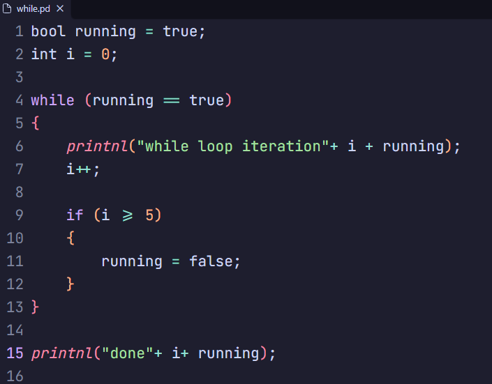
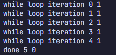

# PPI

PPI is a small C++20 interpreter for the `.pd` language. It includes a lexer, parser, and interpreter for basic variables, expressions, input/output, conditionals, and loops.

## Preview

Example `while` loop:



Its output:



## Build and run

```sh
cmake -S . -B build
cmake --build build
```

Run a program by passing its `.pd` file to the executable:

```powershell
build\bin\Debug\ppi.exe examples\while.pd
```

Use `Release` instead of `Debug` for a release build. On Linux and macOS, use the corresponding executable path under `build/bin`.

## Language features

- `int`, `double`, `string`, and `bool` variables
- Arithmetic, comparison, equality, and unary `+`/`-` operators
- `print`, `printnl`, and `input`
- `if` / `else if` / `else`, `for`, and `while`
- Single-line and block comments
- Prefix and postfix `++` and `--`

See [`examples/syntax.md`](examples/syntax.md) for supported syntax and [`examples/`](examples/) for sample programs.

## VS Code syntax highlighting

Install `pdlex-0.0.1.vsix` from the VS Code Extensions view using **… → Install from VSIX**, then select the file. Search for **PPI** in Extensions to find it afterward.

## License

Apache-2.0. See [`LICENSE`](LICENSE).
